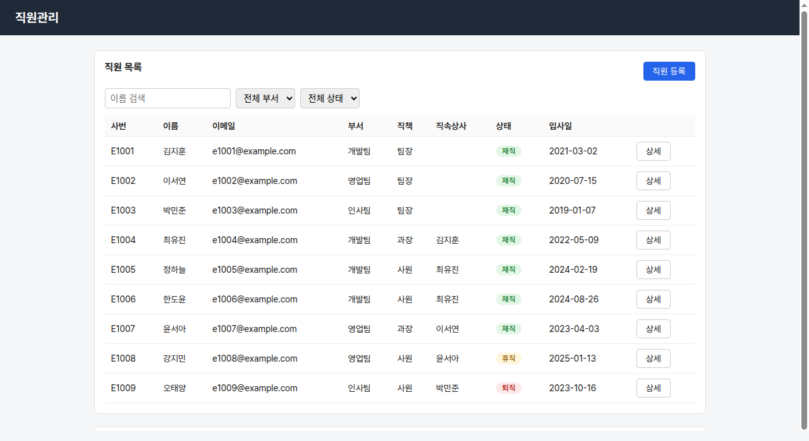
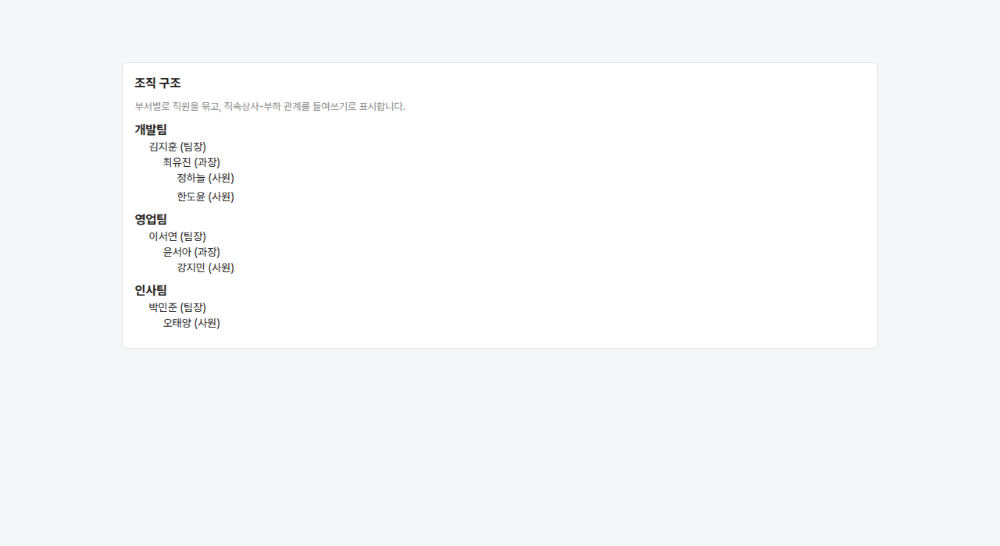
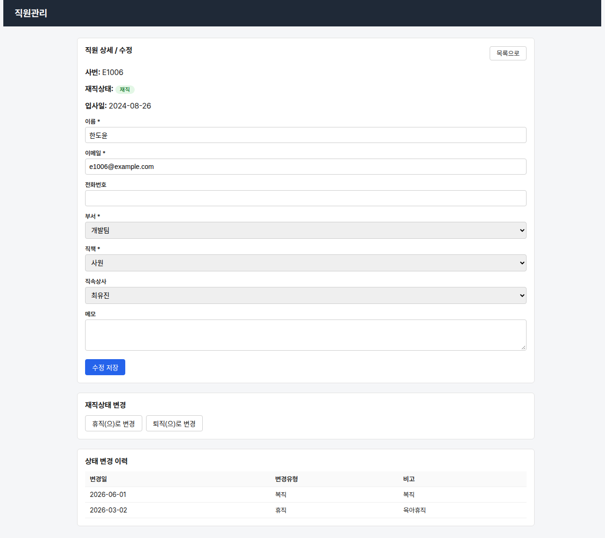
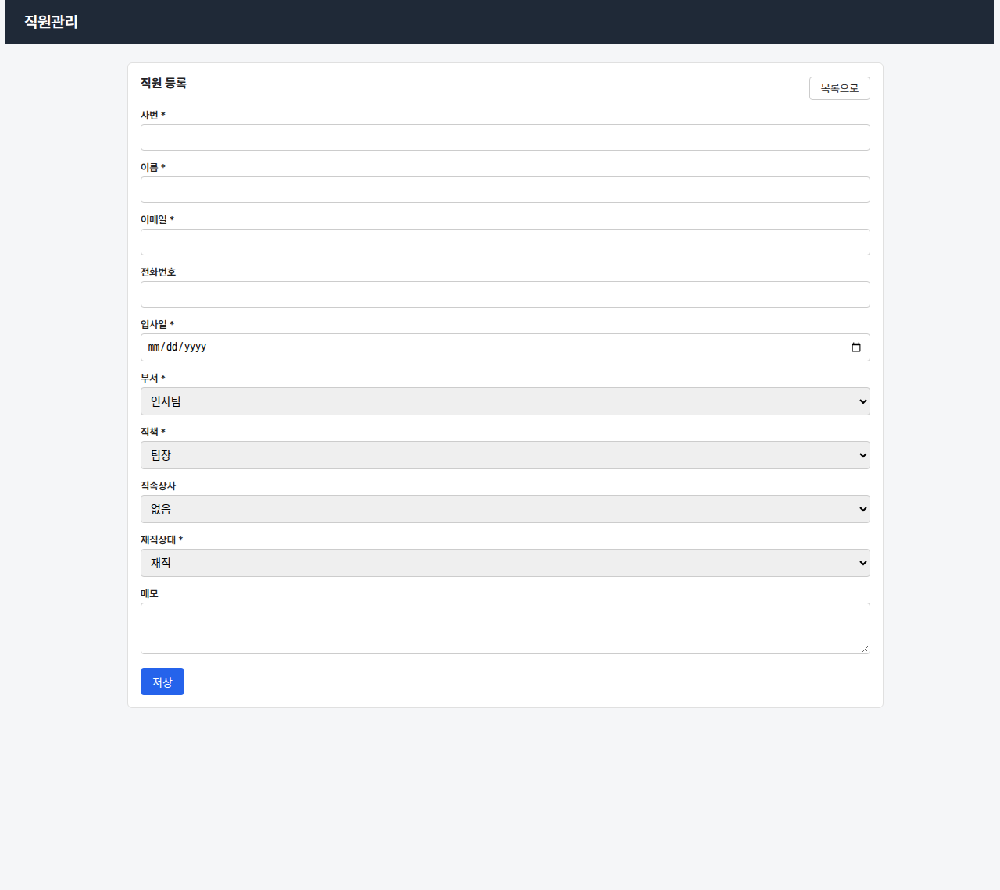

<div align="center">

# 직원관리 웹

ERD를 바탕으로 직원 목록·등록·수정과 재직 상태 변경 이력을 관리하는 웹 서비스


</div>

## 소개

부서, 직책, 직속상사로 이어진 조직 데이터를 PostgreSQL에 두고, 직원 정보와 재직 상태(재직·휴직·퇴직)를 웹에서 관리합니다. 상태가 바뀔 때마다 이력을 남기고, 허용되지 않는 변경은 서버에서 막습니다.

<p align="center">
  
  
</p>
<p align="center">
  
  
</p>

화면의 직원·부서 데이터는 캡처용 가상 데이터입니다.

## 주요 기능

| 기능 | 내용 |
| --- | --- |
| 직원 목록 | 부서명·직책명·직속상사를 함께 보여 줍니다. 검색과 필터, 부서별로 묶어 상사-부하 관계를 들여쓰는 조직 구조 보기를 제공합니다. |
| 직원 등록·수정 | 사번 중복은 409로, 필수값 누락·이메일 형식 오류와 없는 부서·직책·직속상사, 자기 자신을 직속상사로 지정하는 요청은 400으로 막습니다. |
| 재직 상태 변경 | 허용되는 전이를 표(`ALLOWED_TRANSITIONS`)로 정했습니다. `재직↔휴직`, `재직·휴직→퇴직`만 허용하고 퇴직은 되돌릴 수 없습니다. 같은 상태로의 변경과 입사일보다 이른 퇴직일도 막습니다. |
| 변경 이력 | 상태 변경과 이력 저장을 직원 행을 잠근(`FOR UPDATE`) 하나의 트랜잭션에서 처리하고, 오류가 나면 롤백합니다. 상세 화면에서 이력을 볼 수 있습니다. |
| 날짜 처리 | KST 환경에서 `pg`가 `date` 값을 하루 밀어 읽는 문제를 발견해, 쿼리에서 `to_char(..., 'YYYY-MM-DD')` 문자열로 반환하도록 고쳤습니다. |

## 기술 구성


| 구분 | 사용 기술 |
| --- | --- |
| 백엔드 | Node.js(ESM), Express, `pg`(ORM 없이 직접 쿼리), Zod(입력 검증), winston(로그), helmet·cors |
| 프론트엔드 | 프레임워크 없이 HTML·CSS·JavaScript(`fetch`), Express `static`으로 제공 |
| DB | PostgreSQL 16(Docker Compose) |
| 구조 | Router → Controller → Service → Repository 4계층 |

## 데이터 구조

4개 테이블로 조직을 표현합니다. 자세한 내용은 [`docs/guides/employee-erd-guide.md`](docs/guides/employee-erd-guide.md)에 있습니다.

| 테이블 | 내용 |
| --- | --- |
| `T_DEPARTMENT` | 부서. 자기참조로 상위 부서를 표현 |
| `T_POSITION` | 직책 |
| `T_EMPLOYEE` | 직원. 부서·직책 FK, `MANAGER_ID` 자기참조로 직속상사 표현 |
| `T_EMPLOYMENT_HISTORY` | 재직 상태 변경 이력(`CHANGE_TYPE`: 휴직·복직·퇴직) |

생성·수정 시각은 `F_AUDIT_LOG` 트리거 함수가 채웁니다.

## 실행 방법 (WSL / Linux)

Node.js 18 이상과 Docker가 필요합니다.

```bash
# 1. PostgreSQL 실행
docker compose up -d postgres

# 2. 스키마 적용(처음 한 번)
docker compose cp ddl postgres:/ddl
docker compose exec -T -w /ddl postgres psql -U emko -d emko -v ON_ERROR_STOP=1 -f run_all.sql

# 3. (선택) 확인용 부서·직책 샘플 데이터. 다시 실행해도 중복으로 들어가지 않습니다
docker compose exec -T -w /ddl postgres psql -U emko -d emko -f seed.sql

# 4. 서버 실행
npm install
npm run dev   # 또는 npm start
```

DB 연결과 포트는 `.env.example`을 `.env`로 복사해 설정합니다(`.env`는 커밋하지 않습니다).

| 화면 | 주소 |
| --- | --- |
| 직원 목록(검색·필터, 조직 구조 보기) | `http://localhost:3000/` |
| 직원 등록 | `http://localhost:3000/register` |
| 직원 상세·수정(상태 변경, 이력) | `http://localhost:3000/detail?id=<emp_id>` |

부서·직책 데이터가 없으면 등록 화면의 선택 목록이 비어 있습니다. 3번 샘플 데이터를 넣거나 두 테이블에 직접 한 건 이상 넣어 주세요.

## API

| Method | Path | 설명 |
| --- | --- | --- |
| GET | `/employees` | 직원 목록(부서·직책·직속상사 이름 포함) |
| POST | `/employees` | 직원 등록 |
| GET | `/employees/:id` | 직원 상세(상태 변경 이력 `history` 포함) |
| PATCH | `/employees/:id` | 직원 정보 수정 |
| PATCH | `/employees/:id/status` | 재직 상태 변경(이력 저장, 트랜잭션) |
| GET | `/departments` | 부서 목록 |
| GET | `/positions` | 직책 목록 |
| GET | `/health` | 상태 확인 |

응답은 `{ success, data, message, errors? }` 형식입니다. 요청 본문은 camelCase(`empNo`, `deptId`), 응답 데이터는 DB 컬럼명 그대로의 snake_case(`emp_no`, `dept_id`)입니다.

## 폴더 구조

```text
ddl/        스키마 DDL(테이블 4개, F_AUDIT_LOG, run_all.sql, seed.sql)
server/     Express 백엔드(routes, controllers, services, repositories, schemas)
client/     화면 3개(employee-list, employee-form, employee-detail)와 공통 CSS·JS
docs/       ERD 가이드, 검증 체크리스트, 화면 캡처
```

## 검증과 한계

- curl과 `psql`로 API와 DB를 확인했습니다. 등록 2건, 수정, 상태 변경 3회(휴직·복직·퇴직)가 이력 테이블에 1건씩 저장되고, 퇴직→재직 요청은 400으로 막히는 것을 DB에서 직접 확인했습니다. 자세한 내용은 [`docs/reports/result-checklist.md`](docs/reports/result-checklist.md)에 있습니다.
- 위 화면은 임시 PostgreSQL에 가상 데이터를 넣고 띄워 캡처했습니다. 화면에서 직접 클릭해 등록·수정하는 흐름은 자동화 테스트로 확인하지 않았습니다.
- 검색·필터는 이미 불러온 목록을 화면에서 거르는 방식입니다.
- 로그인·권한, 배포, 대용량 페이지네이션은 범위에 넣지 않았습니다.
