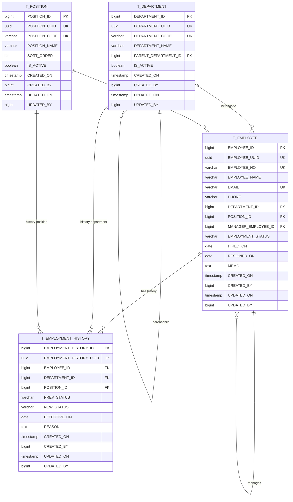

# 직원 구성도 ERD 설계 가이드

## 1. 설계 의도

직원관리 시스템은 단순 직원 목록이 아니라 부서, 직책, 직원, 상태 이력을 통해 조직 구조를 표현한다.

최소 엔티티는 다음 4개다.

1. `T_DEPARTMENT`: 부서
2. `T_POSITION`: 직책
3. `T_EMPLOYEE`: 직원
4. `T_EMPLOYMENT_HISTORY`: 직원 상태/발령 이력

## 2. Mermaid ERD 초안

## 3. 관계 설명

### 부서 관계

- 하나의 부서에는 여러 직원이 속할 수 있다.
- 부서는 상위 부서를 가질 수 있다.
- 최상위 부서는 `PARENT_DEPARTMENT_ID`가 null일 수 있다.

### 직책 관계

- 하나의 직책은 여러 직원에게 부여될 수 있다.
- 직원은 하나의 현재 직책을 가진다.

### 직원 자기참조 관계

- 직원은 직속상사를 가질 수 있다.
- 직속상사도 직원이므로 `T_EMPLOYEE`가 자기 자신을 참조한다.
- 대표 또는 최상위 관리자는 `MANAGER_EMPLOYEE_ID`가 null일 수 있다.

### 상태 이력 관계

- 직원 한 명은 여러 상태 변경 이력을 가질 수 있다.
- 상태 변경 시 기존 상태와 새 상태를 기록한다.
- 부서/직책 변경까지 이력화할 경우 같은 테이블을 확장해 사용할 수 있다.

## 4. 상태값 기준

| 코드 | 표시 | 의미 | 다음 상태 |
|---|---|---|---|
| `ACTIVE` | 재직 | 정상 근무 중 | `LEAVE`, `RESIGNED` |
| `LEAVE` | 휴직 | 복직 가능 | `ACTIVE`, `RESIGNED` |
| `RESIGNED` | 퇴직 | 종료 상태 | 없음 |

## 5. DDL 점검 체크리스트

- [ ] `T_DEPARTMENT`에 부서 코드 unique가 있는가?
- [ ] `T_POSITION`에 직책 코드 unique가 있는가?
- [ ] `T_EMPLOYEE`에 사번 unique가 있는가?
- [ ] `T_EMPLOYEE`에 이메일 unique가 있는가?
- [ ] `T_EMPLOYEE.DEPARTMENT_ID` FK가 있는가?
- [ ] `T_EMPLOYEE.POSITION_ID` FK가 있는가?
- [ ] `T_EMPLOYEE.MANAGER_EMPLOYEE_ID` self FK가 있는가?
- [ ] `EMPLOYMENT_STATUS`가 `ACTIVE`, `LEAVE`, `RESIGNED`만 허용하는가?
- [ ] `T_EMPLOYMENT_HISTORY.EMPLOYEE_ID` FK가 있는가?
- [ ] 감사 컬럼과 감사 트리거가 적용되어 있는가?
- [ ] `ddl/run_all.sql` 실행 순서가 올바른가?

## 6. 구현 시 주의

- 기존 SQL 파일을 먼저 읽고, 부족한 컬럼이나 제약만 보강한다.
- self-referencing FK는 테이블 생성 후 `alter table`로 추가하는 방식이 안전하다.
- seed 데이터가 필요하면 기존 DDL과 분리해 `ddl/seed.sql`로 만든다.
- 스키마 변경이 크면 계획서에 먼저 적고 승인받는다.
